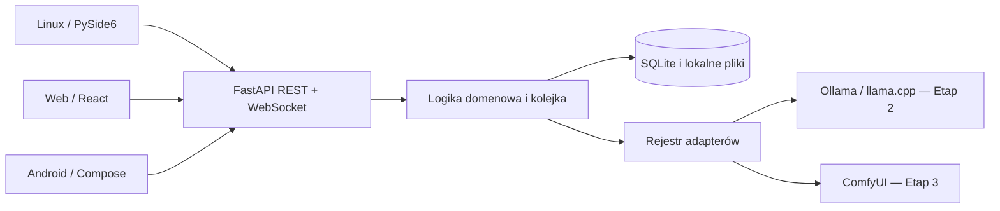
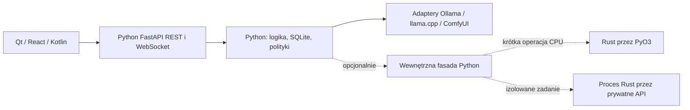

# OmniCore 0.1.0 Alpha — architektura i plan

Decyzja projektowa: 2026-10-28. Wersja robocza nazwy: OmniCore.
Bieżący zakres: zachowany fundament, backend Text AI oraz natywny Linux desktop.
Rzeczywisty GGUF/llama.cpp na CPU i HF zostały zweryfikowane; cała Alpha
ze wszystkimi docelowymi platformami i Image AI pozostaje nieukończona.
Rozszerzenie decyzji z 2026-10-28: docelowo Python oraz opcjonalne komponenty Rust.
Poniższy projekt warstwy natywnej nie zmienia implementacji ukończonego Etapu 1.

## Aktualizacja: Linux desktop i AppImage

Natywny Linux został przesunięty przed Image AI. Klient w
`backend/src/omnicore/desktop` jest osobnym entry pointem/procesem PySide6 6.8.3,
z opcjonalną zależnością `desktop`; backend headless nie importuje Qt. QtNetwork
obsługuje REST i SSE bez blokowania wątku GUI. SQLite, GGUF, pobieranie, kolejka
i inferencja pozostają w istniejących usługach backendu. Nie przepisano Etapu 1.

Backend jest wykrywany przez health; przy braku usługi QProcess uruchamia prywatny
proces loopback z losowym tokenem w środowisku. Klient nie przejmuje cudzych
procesów. Parent-death guard oraz asynchroniczny SIGTERM/kill deadline chronią
własne dzieci. Istniejące API/auth/CORS/limity zachowano, dodając tylko read-only
`/api/v1/text/diagnostics` (CPU/RAM/dysk oraz stany/kody zadań bez treści).
Tokeny nie są w preferencjach, argv, logach ani manifestach paczki.

Lokalny desktop.json przechowuje wyłącznie niesekretne ustawienia GUI i procesu.
Rozszerzenie katalogów modeli wymaga jawnego dialogu i restartu własnego backendu;
publiczne API nie może rozszerzać rootów ani uruchamiać dowolnych poleceń.
Motywy i PL/EN są przełączane w Qt, teksty pochodzą z katalogów JSON.
Szczegóły lifecycle, skrótów i danych: [LINUX_DESKTOP.md](LINUX_DESKTOP.md).

AppImage używa PyInstaller onedir (Python/Qt/backend), zweryfikowanego runtime
AppImage i SquashFS; opcjonalny silnik CPU ma względny RPATH. Zapis danych jest
poza AppDir, a procesy potomne używają tego samego bundlowanego dispatchera.
[APPIMAGE.md](APPIMAGE.md) opisuje rzeczywiście sprawdzony tryb extract-and-run,
ABI hosta budowania, licencje, testy i workflow. Nie deklarujemy CUDA/Wayland.

Przygotowano znaczącą granicę `native/README.md` zamiast pustego Cargo workspace.
Pomiary realnego GGUF i syntetycznego pliku 4 GiB są w `benchmarks/`; nie wykazano
obecnie potrzeby FFI/IPC. Import nie kopiuje wag, hashing już używa natywnej
biblioteki. Rust pozostaje opcjonalny z fallback Python i bramkami opisanymi niżej.

## Rozszerzenie: natywny klient Android

Właściciel dopuścił Android po dostarczeniu Linux AppImage. Osobny projekt
`apps/android` używa Kotlin 2.1.20, Compose/Material 3, AGP 8.9.2 i Gradle 8.11.1.
OmniApi wywołuje to samo `/api/v1`, a OmniViewModel przechowuje projekcję stanu
serwera. Backend pozostaje jedynym właścicielem SQLite, GGUF, pobierania i inferencji.
Nie ma WebView, NDK do inferencji, własnego JNI/Rust ani lokalnych modeli telefonu.

HTTP/SSE działa asynchronicznie przez OkHttp/coroutines, bez wykonywania sieci
w wątku UI. Snapshoty zastępują tekst i porównują sekwencje w obrębie jednego ID.
Unikalny request_key chroni ponowienie po utracie odpowiedzi. Rozłączenie i tło
zachowują częściową historię w backendzie, bez automatycznego ponawiania promptu.
Niesekretne preferencje są lokalne; token AES-GCM używa Android Keystore, backup
wyłączono, redirecty nie przekazują auth. HTTP wymaga świadomego zaufanego LAN,
publiczny adres wymaga HTTPS. Token nie jest ponownie używany dla innego origin.

MinSdk 26, target/compile 35. ARM64 i x86_64 są osobnymi split APK; x86_64 służy
emulatorowi CI. Sam build/podpis nie potwierdza instalacji na fizycznym ARM64.
Zasoby UI PL/EN i Material 3 reagują na system/light/dark. Rust pozostaje opcjonalną
warstwą backendu dopiero po pomiarach, bez kosztu toolchainu dla klienta Android.
Instrukcje LAN, TLS, tokenu, budowania i granice testów: [ANDROID.md](ANDROID.md).

## Audyt wejściowy

- Repozytorium: `github.com/vex2137/OmniCore`; czysty checkout dokumentacji
  `270f2b924b6854c834a5472f7f39d05aea0a26dd`.
- Odczytano wszystkie sześć plików: AGENTS.md, LICENSE, README.md,
  docs/ROADMAP.md, docs/PROGRESS.md, docs/github-access-test.md oraz historię
  czterech commitów. Brak kodu, zależności, CI i istniejących modułów inferencji.
- Zdalny `main` podczas audytu: `0f91a3e9a7ba28cac3324238248e1fda75fdb174`.
  Dokumentacja istnieje na osobnej gałęzi; gałąź funkcjonalna zachowuje jej historię.
- Gałąź implementacji: `feature/0.1.0-alpha`. Nie zmieniamy `main` ani licencji MIT.
- Środowisko: Linux, Python 3.12.14, Node.js 24.19.0, 5 logicznych CPU,
  około 30 GiB wolnego dysku. Testy Etapu 1 nie wymagają GPU ani wag modeli.

## Stos i kompatybilność

| Komponent | Decyzja | Uzasadnienie i ograniczenia |
| --- | --- | --- |
| Backend | Python 3.12+, FastAPI, Pydantic 2, Uvicorn | Headless; OpenAPI 3.1 i JSON Schema; bez zależności od Qt, CUDA i silników modeli |
| Dane | SQLite ze standardowej biblioteki, jawne migracje SQL | Lokalna baza, transakcje, brak serwera DB; jeden proces backendu w Alpha |
| Linux | Qt 6 / PySide6, przesunięty przed Image AI | Natywne okna i dialogi; dobrać wersję do Python 3.12; sprawdzić pakowanie, Wayland i obowiązki licencyjne Qt |
| Web | React + TypeScript, Etap 4 | Samodzielny klient REST/WS; Node.js 24 dostępny, zależności klienta będą przypięte przy implementacji |
| Android | Kotlin + Jetpack Compose, klient API obecnego etapu | Natywny klient zdalnego backendu; JDK/Gradle/SDK dobrać razem; brak inferencji na telefonie w Alpha |
| Kontrakty | Generowane OpenAPI i JSON Schema | Jedno źródło modeli w Pydantic, snapshoty w repozytorium sprawdzane w CI |
| Zależności Python | uv i uv.lock | Powtarzalna instalacja `uv sync --frozen`; backend i narzędzia testowe bez silników AI |
| Opcjonalne komponenty natywne | Rust; PyO3/maturin lub osobny proces API | Wyłącznie po profilowaniu i wykazaniu korzyści; obecnie brak własnego kodu Rust i nowych wymagań budowania |

Nie ma potrzeby zmiany preferowanego stosu. Qt i Android nie są instalowane ani
testowane w Etapie 1. Kompatybilność tych klientów pozostaje do potwierdzenia
rzeczywistym buildem i testami w Etapie 4.

## Granice komponentów

- `backend/src/omnicore`: konfiguracja procesu, modele danych, API, repozytorium
  SQLite, lokalizacja i kontrakt adapterów. Logika inferencji nigdy nie trafia do klientów.
- `backend/src/omnicore/locales`: katalogi `pl-PL.json` i `en-US.json`; źródło wspólnego nazewnictwa
  Chat, Images, Models, Hardware, Settings, preferencji i błędów.
- `contracts`: OpenAPI i schematy konfiguracji, metadanych oraz zdarzeń;
  `contracts/locales` udostępnia wygenerowane kopie katalogów klientom bez zależności od Pythona.
- `backend/tests`: testy bez GPU. Oddzielne testy rzeczywistych silników i GPU
  powstaną wraz z integracjami; brak silnika nie oznacza zaliczonego testu inferencji.
- Linux: `backend/src/omnicore/desktop`; Android: `apps/android` — działające klienty API.
  Klient Web pozostaje planowany. Etap 1 nie zawierał atrap ekranów ani przycisków.

## Etap 1 — dostarczany zakres i kryteria

1. Konfiguracja i backend headless: CLI domyślnie `127.0.0.1:8000`, katalog danych
   poza repozytorium, endpoint zdrowia weryfikujący DB, wersjonowane `/api/v1`.
2. Wspólne modele: preferencje języka, motywu `system/light/dark`, trybu
   `simple/advanced`; metadane modelu i format możliwości adaptera bez deklaracji
   sprawdzonych modeli. Nie implementujemy jeszcze importu wag ani inferencji.
3. SQLite: wersjonowanie `PRAGMA user_version`, migracje transakcyjne, zachowanie
   istniejących preferencji, odrzucenie bazy o nowszym schemacie, test rollbacku.
4. REST: odczyt/zapis ustawień i katalogów lokalizacji, lista rzeczywiście
   zarejestrowanych backendów. WebSocket: powitanie, ping/pong i zdarzenia zapisu
   ustawień. Brak fałszywego streamingu tekstu lub postępu generowania.
5. Lokalizacja: jednakowy zestaw kluczy PL/EN, wybór katalogu bez restartu
   backendu, zapis preferencji. Renderowanie motywów w klientach dopiero w Etapie 4.
6. Walidacja: testy jednostkowe, API, migracji, błędów, lokalizacji, WebSocket,
   kontroli dostępu i zgodności snapshotów kontraktów; CI bez GPU; rzeczywisty
   start Uvicorn i żądanie HTTP. Zakończyć raportem przed Etapem 2.

## Dane i kontrakty

SQLite przechowuje preferencje, a później rozmowy, wiadomości, metadane modeli
i zadania; wagi oraz obrazy pozostaną osobnymi plikami. Identyfikatory domenowe
mają być niezależne od ścieżek. Migracje są dodatnie, numerowane i atomowe;
przed przyszłą migracją istniejących danych użytkownik powinien wykonać kopię bazy.

Pydantic waliduje wejścia i odrzuca nieznane pola. Konfiguracja procesu
(host, port, katalog danych, CORS, uwierzytelnianie) jest odrębna od ustawień UI.
Token nie jest polem modelu ustawień, odpowiedzi API ani metadanych.
Kontrakty zawierają jawne wersje i stabilne kody błędów; komunikat błędu pochodzi
z katalogu wybranego przez `Accept-Language` (domyślnie `en-US`).

## Etap 2 — zaimplementowany backend Text AI

Moduł `backend/src/omnicore/text` realizuje transporty SSE llama.cpp i NDJSON
Ollamy, zarządzanie własnym procesem, ograniczony parser GGUF, katalog modeli,
potwierdzone pobieranie HF, rozmowy i trwałe zadania. Nowe trasy pod
`/api/v1/text` uzupełniają istniejące API, a `generation.updated` rozszerza stary WS.
Szczegóły kontraktów, stanów, konfiguracji i granic: [TEXT_AI.md](TEXT_AI.md).
Instalacja i weryfikacja silników: [ENGINES.md](ENGINES.md).

W tej samej SQLite zachowujemy rdzeniowy `PRAGMA user_version=1`; `text_schema`
wersjonuje osobno transakcyjne migracje modułu. Nowe tabele przechowują metadane,
rozmowy, wiadomości, klucze idempotencji i zadania, nigdy wagi/tokeny.
Zapis snapshotu zadania i odpowiedzi jest atomowy; po awarii zachowujemy treść
i oznaczamy przerwane zadanie bez automatycznego retry. Domyślnie jedna generacja.

Proces native dostaje zweryfikowany deskryptor pliku i argumenty bez powłoki.
Linux bootstrap ustawia sygnał śmierci rodzica; zamknięcie modelu zatrzymuje tylko
własny proces. API nie zarządza ścieżką binarki ani listą dozwolonych katalogów.
Ollama pozostaje opcjonalna i jest traktowana jako zewnętrzny serwer.

To implementacja transportu i usług, nie deklaracja zgodności konkretnych modeli.
Build CPU llama.cpp z `c3df4b7e22a1ac38da663552d19e649dd97ca936` oraz diagnostykę
uruchomiono, ale brak dostępnych wag i blokada HF uniemożliwiły wymagany scenariusz
inferencji bez Ollamy. Oddzielne testy rzeczywiste są w `integration/` i nie mają
fallbacku do mocka. Nie oznaczamy Etapu 2 jako w pełni zaakceptowanego.

## Adaptery i wykonywanie modeli — kolejne etapy

Interfejs adaptera obejmuje identyfikację i wersję, wykrywanie dostępności,
możliwości, start, zdarzenia postępu, anulowanie/zatrzymanie zadania oraz pomiary
zasobów. Nieznane pomiary i wersje są `null`, nigdy wymyśloną wartością.
Rejestr Etapu 1 jest pusty; istnienie protokołu nie potwierdza działania adaptera.

Etap 2 użyje lokalnych API Ollama i serwera llama.cpp. GGUF importujemy przez
referencję i walidację, bez automatycznego kopiowania wielkich wag. Multimodalność
włączamy dopiero po wykryciu możliwości i teście konkretnego modelu/silnika.

Etap 3 użyje API ComfyUI. Każdy workflow musi mieć wersję, wymagane node'y,
modele, licencje, parametry i wynik rzeczywistej próby. Osobne workflowy dla
text-to-image, image-to-image, inpaintingu i upscale; LoRA/CFG/samplery/schedulery
zależne od modelu. Diffusers pozostaje przyszłym adapterem, bez implementacji.

Kolejka inferencji pojawi się z silnikami: domyślnie jedno aktywne zadanie GPU,
ograniczone zasoby, jawne stany, bezpieczne anulowanie i raport OOM. Nie należy
uruchamiać wielu workerów Uvicorn ze współdzieloną kolejką w pamięci.

## Bezpieczeństwo fundamentu

- Domyślnie nasłuch loopback. Zmiana hosta na zdalny wymaga jawnego opt-in
  i tokenu przekazanego przez środowisko, bez zapisu w repozytorium i bazie.
- Zdalny REST i WebSocket wymagają tokenu; porównanie stałoczasowe.
  Dla WebSocket przeglądarki używamy protokołów `omnicore.v1` i `bearer.<token>`;
  serwer negocjuje wyłącznie `omnicore.v1`, nie odsyła sekretu.
- Poza loopback stosować TLS w zaufanym reverse proxy; nigdy nie wysyłać tokenu
  przez niezaufane HTTP. Docelowo tokeny klientów przechowywać w systemowym
  keyringu Linux/Android Keystore, nie w localStorage.
- CORS dopuszcza wyłącznie jawne origins; WebSocket sprawdza Origin osobno.
  Brak `*` z poświadczeniami. Ograniczony rozmiar ciała żądania i komunikatu WS.
- Jawna lista Host chroni lokalny backend przed DNS rebinding; zdalne nazwy/IP
  należy dodać do konfiguracji przy nasłuchu na wszystkich interfejsach.
- Etap 1 nie przyjmuje ścieżek, wag ani uploadów i nie uruchamia poleceń użytkownika.
  Katalog bazy i pliki mają prywatne uprawnienia. Przed uploadami w kolejnych
  etapach: kontrola traversal, symlinków, rozmiaru i izolacja katalogów.
- Nigdy nie wykonywać kodu pobranego razem z modelem bez świadomej zgody.
  Pobieranie wielogigabajtowych modeli wymaga potwierdzenia użytkownika.

## Niezależne etapy i commity

| Etap | Wynik | Warunek przejścia |
| --- | --- | --- |
| Audyt i projekt | Ten dokument, aktualizacja granicy AGENTS | Przegląd istniejących plików i zgodność planu z wymaganiami |
| 1 — Fundament | Backend, DB, kontrakty, lokalizacja, testy, instrukcje | Testy bez GPU i funkcjonalny start, commit, raport; zatrzymanie przed Etapem 2 |
| 2 — Tekst | Ollama, llama.cpp, menedżer modeli, czat, streaming, historia, import/eksport | Testy integracji i rzeczywistej inferencji, błędów i anulowania |
| 3 — Obrazy | ComfyUI, sprawdzone workflowy, maska, LoRA, galeria, kolejka | Wszystkie tryby przetestowane na zgodnych modelach i sprzęcie |
| 4 — Klienci | Linux Qt, Web React, Android Compose | Buildy i testy interfejsów, języków, motywów oraz połączeń |
| 5 — Stabilizacja | Diagnostyka, pamięć, bezpieczeństwo, dokumentacja | Testy końcowe na CachyOS/RTX 4060, brak krytycznych błędów; bez wydania bez zgody |

Wideo, muzyka, TTS/STT, agenci, automatyzacje, trenowanie LoRA i port Windows
pozostają poza 0.1.0. Nie implementować ich jako pustych endpointów lub przycisków.

## Opcjonalna warstwa Rust — decyzja architektoniczna

**Status: zaprojektowana, bez implementacji i bez wyników benchmarków.**
Python 3.12+/FastAPI pozostaje hostem aplikacji i publicznego API; SQLite,
REST/WebSocket, formaty danych i działające funkcje Etapu 1 pozostają zachowane.
Rust ma uzupełniać wybrane operacje, gdy pomiary uzasadnią koszt dodatkowej warstwy.
Nie dodajemy teraz crate'ów, Cargo.toml, maturin, przełączników ani pustych modułów.
Instalacja, testy i uruchamianie fundamentu nie wymagają własnego toolchainu Rust.

### Podział odpowiedzialności i priorytety

| Obszar | Odpowiedzialność Pythona | Potencjalny zakres Rust | Priorytet i warunek |
| --- | --- | --- | --- |
| API, bezpieczeństwo, dane, UI | FastAPI, walidacja Pydantic, autoryzacja, lokalizacja, repozytorium SQLite i migracje; klienci pozostają Qt/React/Kotlin | Brak planu przenoszenia tych elementów | P0: utrzymać zgodność i rozwijać funkcje Alpha |
| Inferencja | Adaptery i sterowanie Ollama, llama.cpp, ComfyUI | Bez własnej implementacji inferencji ani obliczeń GPU | P0: najpierw rzeczywiste integracje i testy modeli |
| Duże pliki | Uprawnienia, referencje plików, licencje, polityka pobierania i usuwania, zapis metadanych | Strumieniowe skanowanie/walidacja, indeksowanie, operacje na fragmentach i ewentualne checksumy | P1: pierwszy kandydat do profilowania po powstaniu importu modeli |
| Kolejka zadań | Stany i trwałość zadania, priorytety, limity, decyzje o retry/anulowaniu, publiczne zdarzenia | Ograniczony wykonawca lub scheduler, jeśli zmierzony narzut kolejki ogranicza przepustowość | P2: po testach rzeczywistej kolejki; nie zastępuje EventHub ustawień |
| Zarządzanie zasobami | Polityka budżetów RAM/VRAM, limity zadań i komunikaty dla użytkownika | Zbieranie/ agregacja liczników OS lub egzekwowanie limitów workera, gdy istnieją odpowiednie API systemowe | P2: tylko udokumentowane braki lub koszt istniejących narzędzi |
| Współbieżność | Orkiestracja asyncio, timeouty, backpressure i bezpieczne mapowanie wyników | Ograniczony pool dla zmierzonych obliczeń CPU lub wielu niezależnych operacji | P2: po porównaniu z thread/process pool i bibliotekami natywnymi |

Priorytety określają kolejność analizy, nie zobowiązanie do napisania każdego
komponentu w Rust. I/O ograniczone przepustowością dysku nie przyspieszy od samej
zmiany języka. `hashlib`, SQLite, Pydantic i biblioteki silników już korzystają
z kodu natywnego; punktem odniesienia jest najlepsza rozsądna implementacja Python
z tymi bibliotekami, nie sztucznie wolny odpowiednik. Odczyt VRAM czy użycie Rust
nie zapewnia rezerwacji pamięci w obcym silniku ani usunięcia błędów GPU.

### Dwa warianty integracji

Linie przerywane oznaczają projekt, nie dostępne komponenty. Publiczne żądania
zawsze przechodzą przez Python; klient nie musi wiedzieć, jak wykonano operację.

| Kryterium | Moduł PyO3, budowany maturin | Osobny proces Rust przez API |
| --- | --- | --- |
| Dobór zadań | Krótkie, ograniczone operacje CPU, mało danych na granicy FFI | Długie zadania, osobne limity i potrzeba restartu/izolacji awarii |
| Koszt komunikacji | Wywołania i konwersje typów; drobne wywołania mogą zniwelować zysk | IPC, serializacja, uruchamianie i nadzór procesu; zwykle większy narzut |
| Awaria | Wspólna przestrzeń pamięci; błąd natywny może zakończyć cały backend | Awaria workera może być odseparowana, lecz sam osobny proces nie jest sandboxem |
| Anulowanie | Kooperacyjne punkty anulowania; brak bezpiecznego wymuszonego zabicia wątku | Sygnał anulowania, timeout i kontrolowane zakończenie własnego workera |
| Dystrybucja | Wheel zależny od OS/architektury i wybranego ABI Pythona | Osobna binarka na OS/architekturę oraz zgodność prywatnego protokołu |

**PyO3/maturin:** ewentualny moduł dostarczać w osobnym, opcjonalnym pakiecie
natywnym; główny pakiet pozostaje budowany obecnym Hatchling. Nie zastępować
istniejącego backendu systemu budowania maturin. Wersje Rust (stable/MSRV),
PyO3 i maturin przypiąć dopiero dla konkretnego komponentu i przetestować z Python
3.12+. `abi3` rozważyć jako sposób zmniejszenia liczby wariantów CPython, po
sprawdzeniu ograniczeń używanych API; nie gwarantuje zgodności OS, CPU ani
automatycznej zgodności wszystkich interpreterów i wariantów free-threaded.

Przekazywać niewielkie struktury lub ograniczone bufory zamiast kopiowania całych
wag przez FFI. Długa praca Rust nie może trzymać GIL, a odłączenie od interpretera
nie zwalnia wątku pętli asyncio: blokujące wywołanie nadal wymaga thread pool
z limitem. Nie używać obiektów Pythona w pracy odłączonej od interpretera.
Mapować błędy na istniejące kody domenowe; panic i błędy natywne nie są mechanizmem
odzyskiwania ani bezpieczną granicą izolacji.

**Osobny proces:** preferować prywatne wersjonowane API lokalne (np. Unix socket
na Linux; loopback HTTP tylko z uwierzytelnianiem). Handshake sprawdza wersję
protokołu i możliwości. Przekazywać ID zadania, parametry i strumień/bezpieczny
uchwyt zasobu zamiast wag w JSON. Worker ponownie weryfikuje dopuszczalne ścieżki
i limity; sam dostęp do IPC nie nadaje prawa do dowolnego pliku lub polecenia.
Wprowadzić timeouty, heartbeat, limit kolejki, backpressure i restart tylko
własnych procesów. Po awarii uzgodnić stan z Pythonem przed retry; identyfikator
idempotencji ma zapobiegać dublowaniu efektów, nie obiecywać wykonania exactly-once.
Rzeczywista izolacja wymaga ograniczeń uprawnień i zasobów OS.

Python pozostaje właścicielem schematu i repozytorium SQLite. Worker nie dostaje
drugiej, niezależnej ścieżki zapisu do tej bazy. Granica procesu nie znosi obecnego
ograniczenia jednego procesu API z rozsyłaniem zdarzeń w pamięci.

### Zgodność i praca bez Rust

- Publiczne REST, WebSocket, OpenAPI, schematy JSON, stany, błędy i semantyka
  anulowania pozostają niezależne od języka wykonawcy. Ewentualny prywatny protokół
  workera ma osobną wersję; nie staje się automatycznie publicznym API.
- Rdzeń uruchamia się bez pakietu/binarki Rust. Przyszły komponent jest jawnie
  włączany i sprawdzany przy starcie; brak lub niezgodność uruchamia sprawdzoną
  ścieżkę Python albo jasny błąd niedostępnej opcjonalnej możliwości.
- Fallback nie powtarza po cichu operacji z efektami ubocznymi. Po awarii najpierw
  ustalić stan i bezpiecznie dokończyć lub odrzucić zadanie.
- Używać obecnych adapterów silników. Rust nie przejmuje GPU, CUDA/ROCm,
  zarządzania modelami w silniku ani nie stanowi dowodu zgodności modelu.

### Koszty utrzymania, budowania i platformy

| Platforma / obszar | Wpływ opcjonalnej warstwy i warunek wdrożenia |
| --- | --- |
| Linux backend i Qt | Osobne artefakty x86_64/aarch64 tylko tam, gdzie wsparcie jest deklarowane; kompatybilność glibc/manylinux lub musl/musllinux, bibliotek i CPU trzeba budować i testować. Build na CachyOS nie dowodzi przenośności wheel. Qt pozostaje klientem API |
| Android | W Alpha Kotlin/Compose łączy się z backendem komputera, więc nie potrzebuje Rust ani Pythona na telefonie. Przyszły lokalny moduł wymaga osobnego projektu NDK/ABI, JNI/UniFFI i testów urządzeń; wheel PyO3 z Linux nie działa automatycznie na Androidzie |
| Web | React/TypeScript nadal używa REST/WS; bez kompilatora Rust u użytkownika. WebAssembly jest osobną decyzją, poza tym rozszerzeniem i bez utożsamiania z PyO3 |
| Budowanie i CI | Toolchain/MSRV, Cargo.lock i zgodność PyO3/maturin, cache, macierz wheel/binarek, instalacja gotowych artefaktów i testy obu ścieżek; obecne testy bez Rust muszą pozostać obowiązkowe |
| Utrzymanie i bezpieczeństwo | Kompetencje w dwóch językach, diagnostyka FFI/IPC, przegląd zależności/licencji, aktualizacje podatności, kontrola `unsafe`, nakład na obsługę awarii i kompatybilność |
| Dystrybucja | Zachować sumy kontrolne i weryfikację artefaktów; brak wheel nie może powodować nieoczekiwanej instalacji kompilatora lub obowiązkowego builda Rust przy zwykłym setupie |

Na tym etapie nie potwierdzono kompilacji ani zgodności żadnego własnego komponentu
Rust. Nie dodajemy toolchainu do standardowego setupu/CI. Dodatkowy job Rust,
pakiet lub binarka powstają dopiero po przejściu bramki technicznej.

### Plan stopniowy i mierzalna bramka wdrożenia

1. **Teraz:** zachować działający Etap 1 i dopisać tę decyzję. Następnym zadaniem
   funkcjonalnym nadal są integracje tekstowe Etapu 2; nie uzależniać ich od Rust.
2. **Profilowanie:** po powstaniu rzeczywistego importu/kolejki zarejestrować
   problem użytkownika i powtarzalny workload. Zmierzyć czas całej operacji,
   medianę/p95, przepustowość, CPU, peak RSS, responsywność API i koszt kopiowania.
   Zapisać sprzęt, rozmiar danych, cache zimny/ciepły, poziom współbieżności,
   liczbę prób dobraną do wariancji i surowe wyniki. Bez automatycznego pobierania wag.
3. **Decyzja przed prototypem:** porównać Python + biblioteki natywne i dostępne
   thread/process pool. Wybrać jedną operację i PyO3 albo proces według potrzeby
   izolacji. Zapisać budżet zasobów, cel i koszt utrzymania w decyzji technicznej.
   Przykładowa bramka to co najmniej 20% poprawy p95 całego przepływu lub peak RSS
   bez pogorszenia poprawności i uzgodnionych limitów API. To proponowany próg,
   nie wynik pomiaru ani uniwersalna obietnica. Cel izolacji może zamiast tego
   wymagać dowodu przeżycia awarii workera i dotrzymania budżetu narzutu.
4. **Warunkowy prototyp:** dopiero z konkretnym uzasadnieniem utworzyć minimalny
   komponent, testować w trybie release i porównać z tym samym baseline. Wliczyć
   FFI/IPC, start procesu i dostęp do dysku. Jeśli cel nie został osiągnięty,
   pozostawić Python i zapisać negatywny wynik; nie wdrażać Rust na siłę.
5. **Wdrożenie opcjonalne:** po pozytywnym wyniku dodać osobny artefakt, testy
   z Rust i bez niego, zgodność wyników, instalację wheel/binarki oraz próby błędów,
   anulowania, timeoutów, OOM i restartu. Snapshoty publicznych kontraktów muszą
   pozostać zgodne; każda zmiana API wymaga osobnej uzasadnionej decyzji.
6. **Obserwacja i rollback:** ograniczyć współbieżność i zakres początkowego użycia,
   porównywać metryki, zapewnić możliwość wyłączenia. Dopiero kolejne pomiary
   mogą uzasadnić rozszerzenie na zasoby lub wykonawcę kolejki.

Źródła techniczne sprawdzone 2026-10-28:
[PyO3 — oficjalny README](https://github.com/PyO3/pyo3/blob/main/README.md)
oraz [maturin — oficjalny README](https://github.com/PyO3/maturin/blob/main/README.md).
Potwierdzają model rozszerzeń i koszty pakowania; nie są wynikami testów OmniCore.

## Ryzyka techniczne i sposób weryfikacji

| Ryzyko | Plan ograniczenia / dowód |
| --- | --- |
| RTX 4060 i ograniczona VRAM | Pomiar na rzeczywistym CachyOS; nie zakładać pojemności ani wsparcia FLUX; limity, kolejka i test OOM |
| NVIDIA / AMD / Intel / CPU | Wykrywanie możliwości, jawne macierze; osobne próby na posiadanym sprzęcie, bez obietnicy pełnej zgodności |
| Zmienność API silników i ComfyUI node'ów | Przypięte testowane wersje i workflowy, testy integracji, jawne błędy braku możliwości |
| Licencje i ogromne modele | Metadane licencji i checksum, pobieranie po potwierdzeniu, resume tylko gdy źródło wspiera |
| SQLite i równoległość | Krótkie transakcje, busy timeout, WAL; pojedynczy proces, testy trwałości i migracji |
| Zdalny dostęp Android/Web | Token, kontrola Origin/CORS, TLS i bezpieczny magazyn klienta; testy odmowy dostępu |
| Qt/Wayland i Android toolchain | Oddzielne buildy i testy GUI w Etapie 4, brak deklaracji ukończenia na podstawie kodu |
| Brak GPU/urządzeń w CI | CI tylko bez GPU; testy sprzętowe osobno z wynikiem i środowiskiem, nie jako pozorne PASS |
| Rozjazd dokumentacji i implementacji | Snapshot OpenAPI/JSON Schema, testy kontraktów, aktualizacja PROGRESS po etapie |
| Narzut i utrzymanie Rust | Najpierw profilowanie i cel; oddzielne opcjonalne artefakty; porównanie z Pythonem uwzględnia FFI/IPC oraz dysk |
| FFI, awaria workera i rozjazd stanu | Brak automatycznej izolacji przez PyO3; testy awarii/timeoutów, uzgodnienie stanu przed retry, jeden właściciel SQLite |
