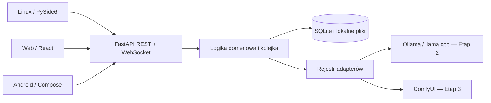

# OmniCore 0.1.0 Alpha — architektura i plan

Decyzja projektowa: 2026-10-28. Wersja robocza nazwy: OmniCore.
Zakres bieżącej implementacji: **Etap 1 — Fundament**. Nie jest to kompletna Alpha.

## Audyt wejściowy

- Repozytorium: `github.com/vex2137/OmniCore`; czysty checkout dokumentacji
  `270f2b924b6854c834a5472f7f39d05aea0a26dd`.
- Odczytano wszystkie sześć plików: AGENTS.md, LICENSE, README.md,
  docs/ROADMAP.md, docs/PROGRESS.md, docs/github-access-test.md oraz historię
  czterech commitów. Brak kodu, zależności, CI i istniejących modułów inferencji.
- Zdalny `main` podczas audytu: `0f91a3e9a7ba28cac3324238248e1fda75fdb174`.
  Dokumentacja istnieje na osobnej gałęzi; gałąź funkcjonalna zachowuje jej historię.
- Gałąź implementacji: `feature/0.1.0-alpha`. Nie zmieniamy `main` ani licencji MIT.
- Środowisko: Linux, Python 3.12.14, Node.js 24.19.0, 5 logicznych CPU,
  około 30 GiB wolnego dysku. Testy Etapu 1 nie wymagają GPU ani wag modeli.

## Stos i kompatybilność

| Komponent | Decyzja | Uzasadnienie i ograniczenia |
| --- | --- | --- |
| Backend | Python 3.12+, FastAPI, Pydantic 2, Uvicorn | Headless; OpenAPI 3.1 i JSON Schema; bez zależności od Qt, CUDA i silników modeli |
| Dane | SQLite ze standardowej biblioteki, jawne migracje SQL | Lokalna baza, transakcje, brak serwera DB; jeden proces backendu w Alpha |
| Linux | Qt 6 / PySide6, Etap 4 | Natywne okna i dialogi; dobrać wersję do Python 3.12; sprawdzić pakowanie, Wayland i obowiązki licencyjne Qt |
| Web | React + TypeScript, Etap 4 | Samodzielny klient REST/WS; Node.js 24 dostępny, zależności klienta będą przypięte przy implementacji |
| Android | Kotlin + Jetpack Compose, Etap 4 | Natywny klient zdalnego backendu; JDK/Gradle/SDK dobrać razem; brak inferencji na telefonie w Alpha |
| Kontrakty | Generowane OpenAPI i JSON Schema | Jedno źródło modeli w Pydantic, snapshoty w repozytorium sprawdzane w CI |
| Zależności Python | uv i uv.lock | Powtarzalna instalacja `uv sync --frozen`; backend i narzędzia testowe bez silników AI |

Nie ma potrzeby zmiany preferowanego stosu. Qt i Android nie są instalowane ani
testowane w Etapie 1. Kompatybilność tych klientów pozostaje do potwierdzenia
rzeczywistym buildem i testami w Etapie 4.

## Granice komponentów

- `backend/src/omnicore`: konfiguracja procesu, modele danych, API, repozytorium
  SQLite, lokalizacja i kontrakt adapterów. Logika inferencji nigdy nie trafia do klientów.
- `shared/locales`: katalogi `pl-PL.json` i `en-US.json`; źródło wspólnego nazewnictwa
  Chat, Images, Models, Hardware, Settings, preferencji i błędów.
- `contracts`: OpenAPI i schematy konfiguracji, metadanych oraz zdarzeń.
- `backend/tests`: testy bez GPU. Oddzielne testy rzeczywistych silników i GPU
  powstaną wraz z integracjami; brak silnika nie oznacza zaliczonego testu inferencji.
- Katalogi aplikacji Linux, Web i Android powstaną z działającymi klientami w Etapie 4.
  W Etapie 1 nie tworzymy ekranów i przycisków pozorujących funkcje.

## Etap 1 — dostarczany zakres i kryteria

1. Konfiguracja i backend headless: CLI domyślnie `127.0.0.1:8000`, katalog danych
   poza repozytorium, endpoint zdrowia weryfikujący DB, wersjonowane `/api/v1`.
2. Wspólne modele: preferencje języka, motywu `system/light/dark`, trybu
   `simple/advanced`; metadane modelu i format możliwości adaptera bez deklaracji
   sprawdzonych modeli. Nie implementujemy jeszcze importu wag ani inferencji.
3. SQLite: wersjonowanie `PRAGMA user_version`, migracje transakcyjne, zachowanie
   istniejących preferencji, odrzucenie bazy o nowszym schemacie, test rollbacku.
4. REST: odczyt/zapis ustawień i katalogów lokalizacji, lista rzeczywiście
   zarejestrowanych backendów. WebSocket: powitanie, ping/pong i zdarzenia zapisu
   ustawień. Brak fałszywego streamingu tekstu lub postępu generowania.
5. Lokalizacja: jednakowy zestaw kluczy PL/EN, wybór katalogu bez restartu
   backendu, zapis preferencji. Renderowanie motywów w klientach dopiero w Etapie 4.
6. Walidacja: testy jednostkowe, API, migracji, błędów, lokalizacji, WebSocket,
   kontroli dostępu i zgodności snapshotów kontraktów; CI bez GPU; rzeczywisty
   start Uvicorn i żądanie HTTP. Zakończyć raportem przed Etapem 2.

## Dane i kontrakty

SQLite przechowuje preferencje, a później rozmowy, wiadomości, metadane modeli
i zadania; wagi oraz obrazy pozostaną osobnymi plikami. Identyfikatory domenowe
mają być niezależne od ścieżek. Migracje są dodatnie, numerowane i atomowe;
przed przyszłą migracją istniejących danych użytkownik powinien wykonać kopię bazy.

Pydantic waliduje wejścia i odrzuca nieznane pola. Konfiguracja procesu
(host, port, katalog danych, CORS, uwierzytelnianie) jest odrębna od ustawień UI.
Token nie jest polem modelu ustawień, odpowiedzi API ani metadanych.
Kontrakty zawierają jawne wersje i stabilne kody błędów; komunikat błędu pochodzi
z katalogu wybranego przez `Accept-Language` (domyślnie `en-US`).

## Adaptery i wykonywanie modeli — kolejne etapy

Interfejs adaptera obejmuje identyfikację i wersję, wykrywanie dostępności,
możliwości, start, zdarzenia postępu, anulowanie/zatrzymanie zadania oraz pomiary
zasobów. Nieznane pomiary i wersje są `null`, nigdy wymyśloną wartością.
Rejestr Etapu 1 jest pusty; istnienie protokołu nie potwierdza działania adaptera.

Etap 2 użyje lokalnych API Ollama i serwera llama.cpp. GGUF importujemy przez
referencję i walidację, bez automatycznego kopiowania wielkich wag. Multimodalność
włączamy dopiero po wykryciu możliwości i teście konkretnego modelu/silnika.

Etap 3 użyje API ComfyUI. Każdy workflow musi mieć wersję, wymagane node'y,
modele, licencje, parametry i wynik rzeczywistej próby. Osobne workflowy dla
text-to-image, image-to-image, inpaintingu i upscale; LoRA/CFG/samplery/schedulery
zależne od modelu. Diffusers pozostaje przyszłym adapterem, bez implementacji.

Kolejka inferencji pojawi się z silnikami: domyślnie jedno aktywne zadanie GPU,
ograniczone zasoby, jawne stany, bezpieczne anulowanie i raport OOM. Nie należy
uruchamiać wielu workerów Uvicorn ze współdzieloną kolejką w pamięci.

## Bezpieczeństwo fundamentu

- Domyślnie nasłuch loopback. Zmiana hosta na zdalny wymaga jawnego opt-in
  i tokenu przekazanego przez środowisko, bez zapisu w repozytorium i bazie.
- Zdalny REST i WebSocket wymagają tokenu; porównanie stałoczasowe.
  Dla WebSocket przeglądarki używamy protokołów `omnicore.v1` i `bearer.<token>`;
  serwer negocjuje wyłącznie `omnicore.v1`, nie odsyła sekretu.
- Poza loopback stosować TLS w zaufanym reverse proxy; nigdy nie wysyłać tokenu
  przez niezaufane HTTP. Docelowo tokeny klientów przechowywać w systemowym
  keyringu Linux/Android Keystore, nie w localStorage.
- CORS dopuszcza wyłącznie jawne origins; WebSocket sprawdza Origin osobno.
  Brak `*` z poświadczeniami. Ograniczony rozmiar ciała żądania i komunikatu WS.
- Etap 1 nie przyjmuje ścieżek, wag ani uploadów i nie uruchamia poleceń użytkownika.
  Katalog bazy i pliki mają prywatne uprawnienia. Przed uploadami w kolejnych
  etapach: kontrola traversal, symlinków, rozmiaru i izolacja katalogów.
- Nigdy nie wykonywać kodu pobranego razem z modelem bez świadomej zgody.
  Pobieranie wielogigabajtowych modeli wymaga potwierdzenia użytkownika.

## Niezależne etapy i commity

| Etap | Wynik | Warunek przejścia |
| --- | --- | --- |
| Audyt i projekt | Ten dokument, aktualizacja granicy AGENTS | Przegląd istniejących plików i zgodność planu z wymaganiami |
| 1 — Fundament | Backend, DB, kontrakty, lokalizacja, testy, instrukcje | Testy bez GPU i funkcjonalny start, commit, raport; zatrzymanie przed Etapem 2 |
| 2 — Tekst | Ollama, llama.cpp, menedżer modeli, czat, streaming, historia, import/eksport | Testy integracji i rzeczywistej inferencji, błędów i anulowania |
| 3 — Obrazy | ComfyUI, sprawdzone workflowy, maska, LoRA, galeria, kolejka | Wszystkie tryby przetestowane na zgodnych modelach i sprzęcie |
| 4 — Klienci | Linux Qt, Web React, Android Compose | Buildy i testy interfejsów, języków, motywów oraz połączeń |
| 5 — Stabilizacja | Diagnostyka, pamięć, bezpieczeństwo, dokumentacja | Testy końcowe na CachyOS/RTX 4060, brak krytycznych błędów; bez wydania bez zgody |

Wideo, muzyka, TTS/STT, agenci, automatyzacje, trenowanie LoRA i port Windows
pozostają poza 0.1.0. Nie implementować ich jako pustych endpointów lub przycisków.

## Ryzyka techniczne i sposób weryfikacji

| Ryzyko | Plan ograniczenia / dowód |
| --- | --- |
| RTX 4060 i ograniczona VRAM | Pomiar na rzeczywistym CachyOS; nie zakładać pojemności ani wsparcia FLUX; limity, kolejka i test OOM |
| NVIDIA / AMD / Intel / CPU | Wykrywanie możliwości, jawne macierze; osobne próby na posiadanym sprzęcie, bez obietnicy pełnej zgodności |
| Zmienność API silników i ComfyUI node'ów | Przypięte testowane wersje i workflowy, testy integracji, jawne błędy braku możliwości |
| Licencje i ogromne modele | Metadane licencji i checksum, pobieranie po potwierdzeniu, resume tylko gdy źródło wspiera |
| SQLite i równoległość | Krótkie transakcje, busy timeout, WAL; pojedynczy proces, testy trwałości i migracji |
| Zdalny dostęp Android/Web | Token, kontrola Origin/CORS, TLS i bezpieczny magazyn klienta; testy odmowy dostępu |
| Qt/Wayland i Android toolchain | Oddzielne buildy i testy GUI w Etapie 4, brak deklaracji ukończenia na podstawie kodu |
| Brak GPU/urządzeń w CI | CI tylko bez GPU; testy sprzętowe osobno z wynikiem i środowiskiem, nie jako pozorne PASS |
| Rozjazd dokumentacji i implementacji | Snapshot OpenAPI/JSON Schema, testy kontraktów, aktualizacja PROGRESS po etapie |
